# Gestão de Resíduos Sólidos

 ## Resíduos Sólidos - Back-End
 Backend para o gerenciamento de usuários e ocorrências. O sistema permite cadastrar, listar, atualizar e excluir usuários e ocorrências.
 
 ---

## MER & DER conceitual e lógico
---

---
## UML - DC (Diagrama de Classe)
---
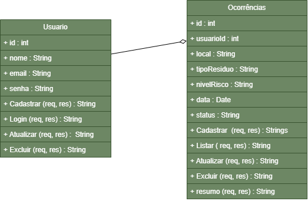

---

## Tecnologias Utilizadas
---
 - Node.js
 - Java Script
 - Insomnia
 - XAMPP
 - MariaDB / MySQL
 - VS Code
 ---

 ## Instruções para testar
 ---
 1 - Use os códigos no repositório acima, inicie o servidor no terminal (CMD) com as dependências:

 - npm init -y
 - npm i express cors
 - npm install mysql
 - npm run dev

2 - Inicie uma nova página no Insomnia, usando o link do servidor, e teste os códigos.

---

## Insomnia
---
 - Listar Usuários

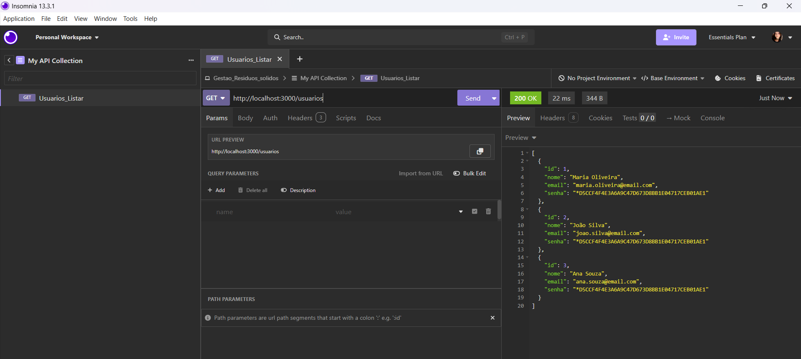

 - Login Usuários

 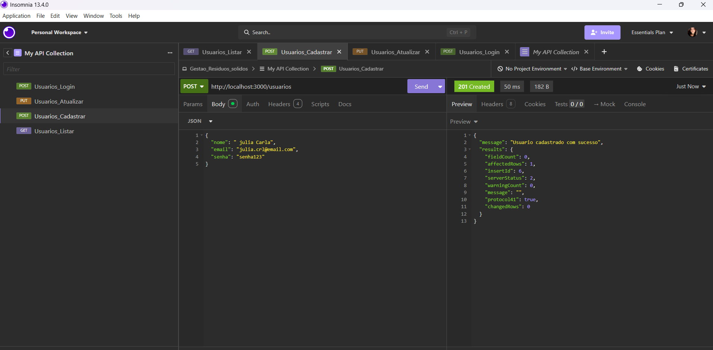

  - Cadastrar Usuários

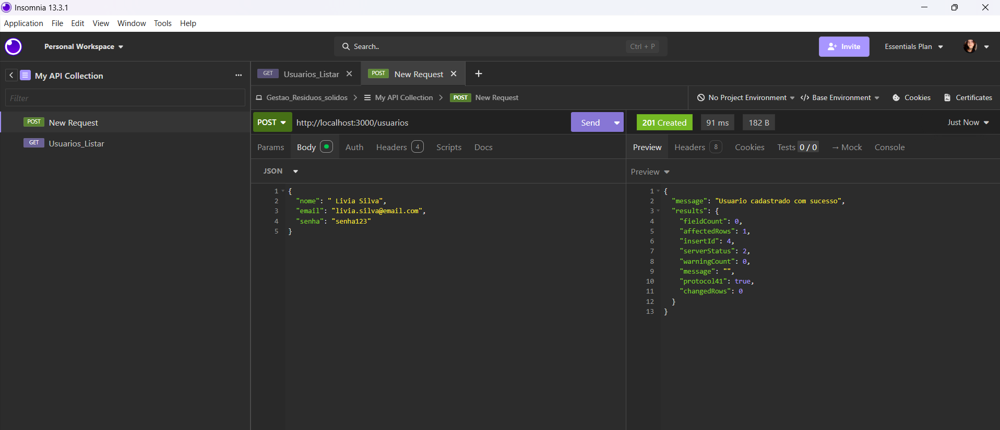

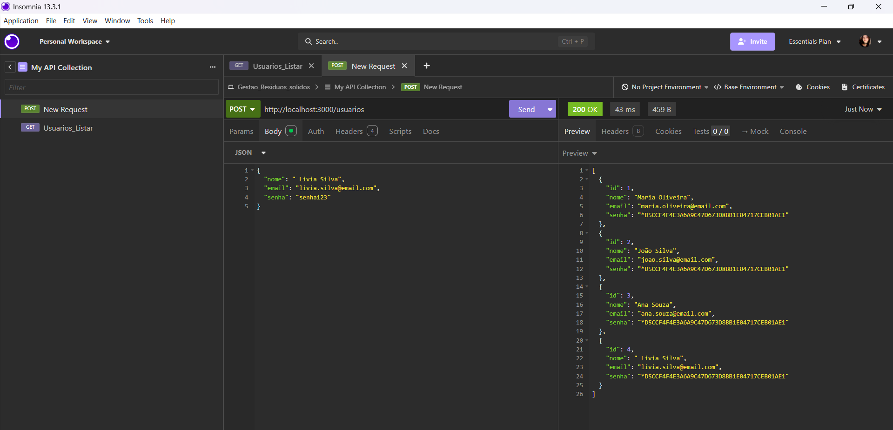

 - Alterar Usuários 

 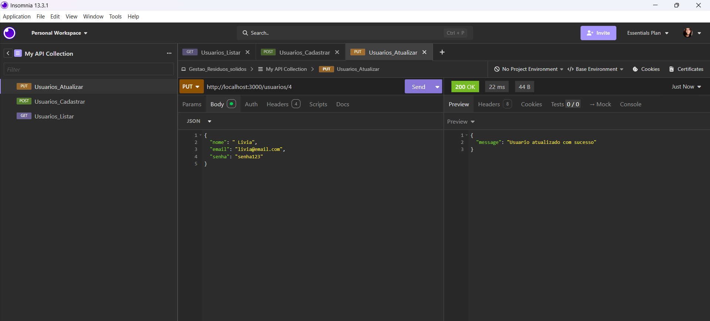

 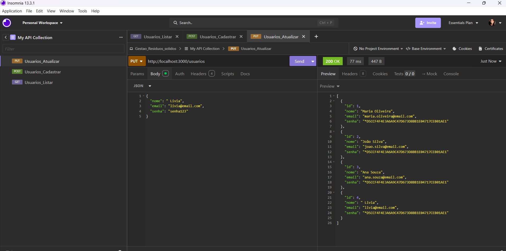

  - Excluir Usuários 

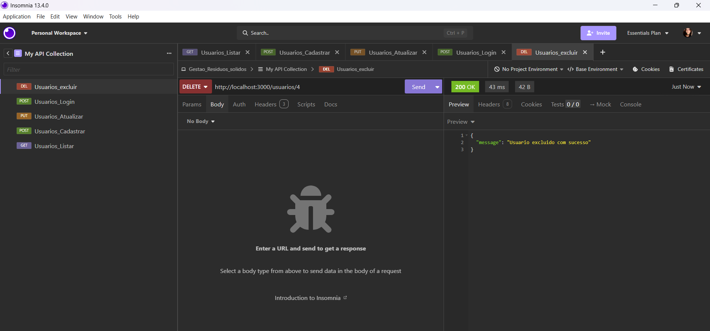

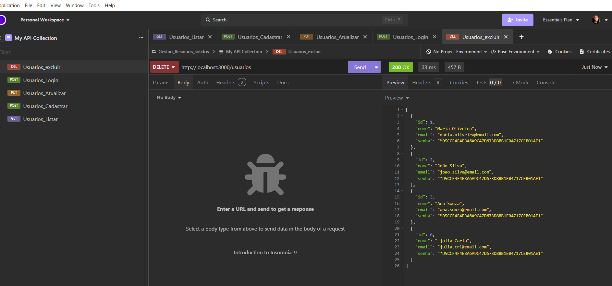

 - Listar Ocorrências

 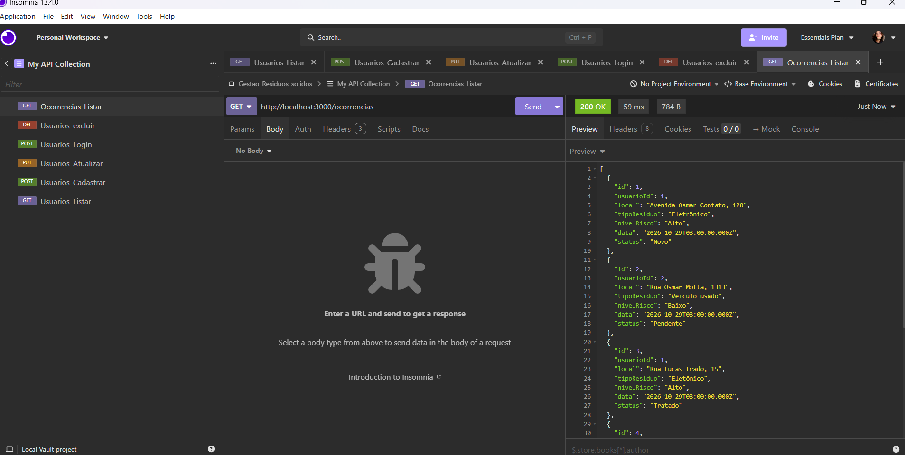

  - Cadastrar Ocorrencias 

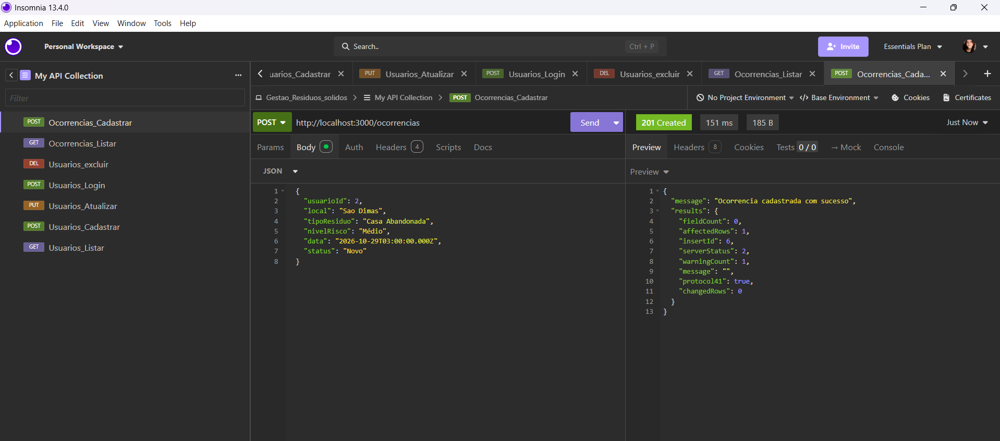

   - Alterar Ocorrencias

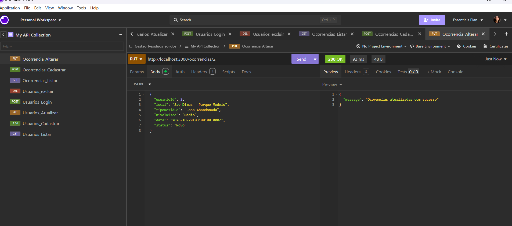

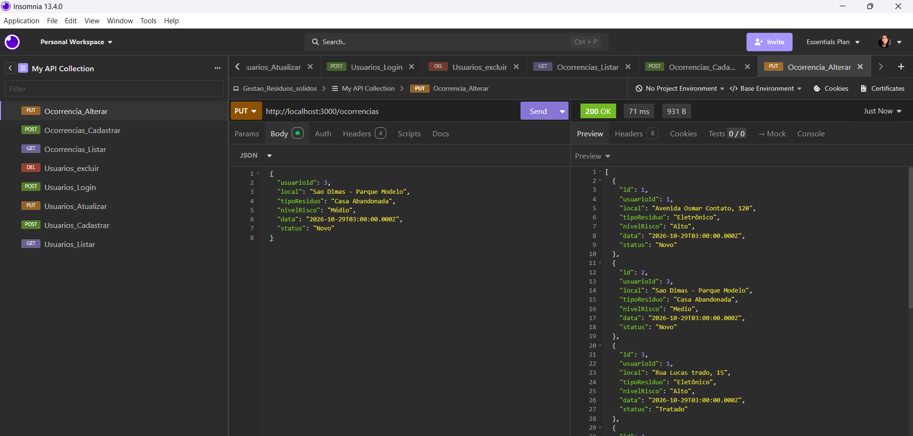

 - Excluir Ocorrencias 

 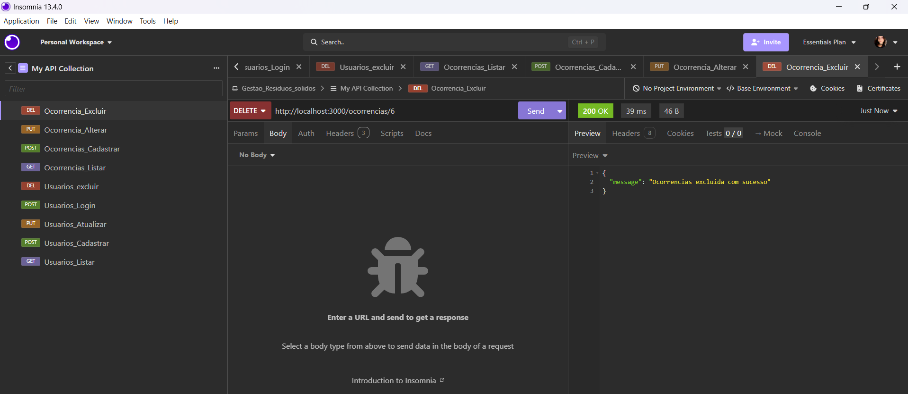

 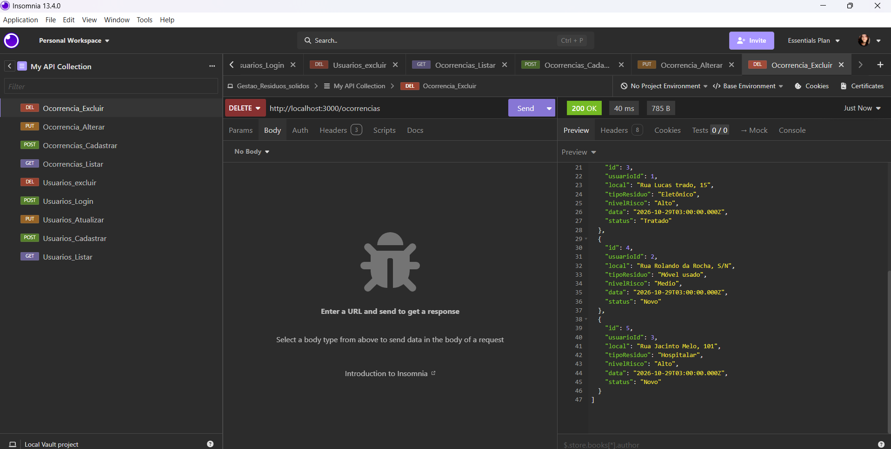

 ---
